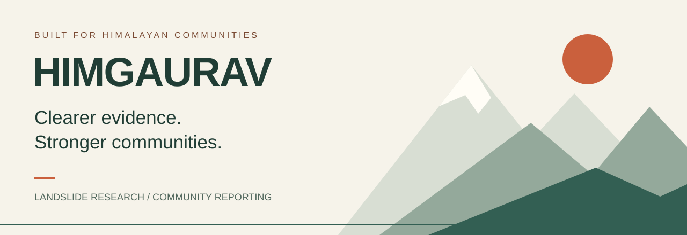
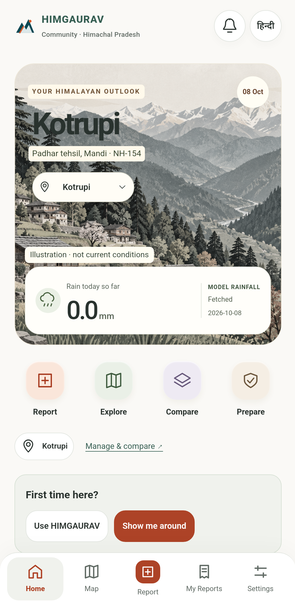
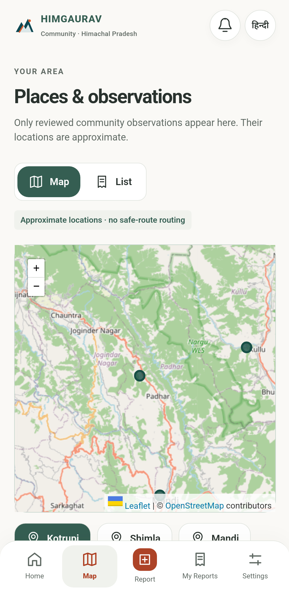

  

# HIMGAURAV · Himalayan Landslide Research & Community Reporting

**Local observations. Traceable evidence. Human review.**

HIMGAURAV brings community reporting, rainfall context and geospatial research into one connected experience designed for Himachal Pradesh. Its purpose is to help people understand available information and help authorized reviewers evaluate observations—without presenting uncertainty as certainty.

[Explore the experience](#a-look-inside) · [Read the judges’ brief](docs/JUDGES-BRIEF.md) · [Understand the boundaries](#built-with-honest-boundaries) · [Privacy](SECURITY.md)

> **Public showcase only.** Application source, operational configuration and user data are private. HIMGAURAV is a research prototype—not a government warning system, validated landslide predictor or emergency-dispatch service.

## Why this project exists

Mountain communities need understandable local information. Reviewers need context, provenance and a way to assess what people report. Researchers need to distinguish model outputs, satellite products, sensor observations and experimental results.

HIMGAURAV connects these needs while keeping the experiences distinct: simple for the community, evidence-focused for authorized teams.

## One project. Two purposeful experiences.

| Community experience | Operations & research experience |
| --- | --- |
| English/Hindi interface and guided reporting | Restricted staff access and scoped review |
| Place-based outlook and map exploration | Review, clarification and decision history |
| Device-local drafts and private report receipts | Controlled publication of reviewed summaries |
| Preparation guidance and accessibility preferences | Rainfall, sensor and Earth-observation research context |

**The core workflow:** observe → submit deliberately → review → clarify → share an approved summary when appropriate.

An uploaded report is not automatically a verified observation. A verified observation is not automatically a warning.

## A look inside

  
  &nbsp;&nbsp;&nbsp;
  

*Actual Android emulator captures from 8 October 2026. These are historical interface examples, not current weather, a live risk map or proof of physical-device validation. The mountain scene is an illustration. Map attribution is retained.*

## What makes the approach different

### Evidence before certainty

Source labels and timestamps matter. Model rainfall is not a rain-gauge measurement; missing data is not zero; unavailable information should stay visibly unavailable.

### People before dashboards

Community users get reporting, local context and preparation guidance. Specialist research tools belong in the restricted workspace, not in the everyday community journey.

### Privacy by separation

Drafts and preferences can remain on the device. Submitting a report deliberately sends information to the service. Public publication is a separate review decision—not an automatic consequence of submission.

### Shared web and Android foundation

The project uses a shared application foundation for browser and Android experiences. Native capabilities still require device-specific validation and permission handling.

## Verification snapshot

The October 2026 v9.11 publication checks recorded:

- **19 passing science/data tests**, including missing-data handling and preserved scientific boundaries.
- **18 passing backend tests**, covering access, review workflow and related boundaries.
- A successful web build and prior Android emulator checks.

These results describe a tested build, not a security certification, field validation or guarantee that every external provider is available. The verification snapshot is dated and is not a live CI status badge.

## Built with honest boundaries

Physical-device location and end-to-end notification delivery still need verification. Automatic closed-app incident subscriptions are not implemented. Official feeds and restricted data sources depend on external authorization and availability. Hosting needs an available backend; free-tier infrastructure does not provide unlimited capacity or guaranteed uptime.

Scientific research modules—including satellite/SAR context, validation experiments and post-event research—must not be presented as operational prediction or rescue capabilities without appropriate independent validation.

## For judges, reviewers and collaborators

Start with the [two-minute project brief](docs/JUDGES-BRIEF.md). It covers the problem, product, demonstration story, evidence and next validation steps without exposing implementation details.

Project owner: [Rohan Gautam](https://github.com/Rohan-minetheift). Public feedback should concern the presentation or non-sensitive product ideas. Do not post real incident reports, precise private locations or credentials on GitHub.

## About this repository

This repository contains only curated public-facing materials. It does not distribute the app source, backend, API credentials, APK, production data or private technical documentation. No source-code license is granted by this showcase. Third-party names and map attribution remain the property of their respective owners.

See [publication and privacy boundaries](SECURITY.md).
